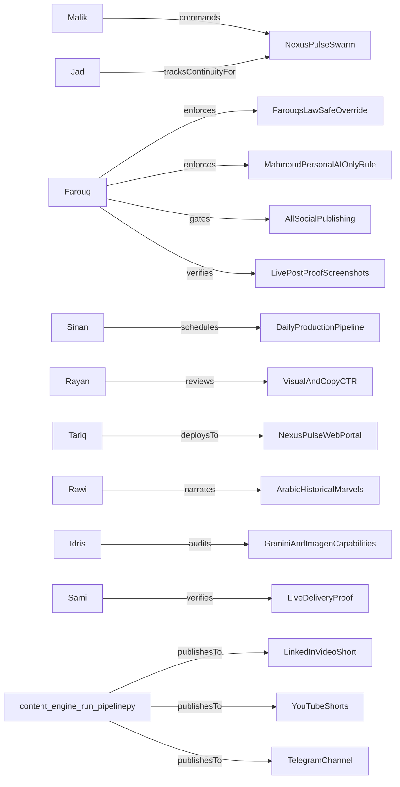

# 🏛️ Nexus Pulse Swarm Ontology & Media Knowledge Graph

> **Maintained by**: Jad // Swarm Ontologist & Continuity Sentinel  
> **Last Synced**: `2026-10-26T08:40:43.395630+00:00` | **Active Commit**: `f5f4a82`

---

## 📍 Active Context Checkpoint (Zero Context Loss)

- **Current Phase**: `PHASE_FULL_AUTONOMY`
- **Last Verified State**: Daily multi-channel distribution verified: LinkedIn video short live, carousel live, personal repost active for AI.
- **Next Immediate Objectives**:
  - [ ] Maintain continuous automated state capture via Jad on every media generation run.
  - [ ] Ensure daily 06:00 AM briefing, carousel, and video short pipelines run without manual intervention.
  - [ ] Continuously enforce Farouq's anti-repetition and platform rate limit rules.

---

## 👥 Autonomous Media Swarm Leadership

| Agent | Role | Focus | Status |
| :--- | :--- | :--- | :--- |
| **Malik** | Swarm Conductor & General Orchestrator | Overall swarm conductor, task decomposition, and non-negotiable omni-media syndication enforcement | `COMMANDING` |
| **Farouq** | Chief Compliance Officer | Platform anti-ban rules, 20m cooldowns, Farouq's Law (unilateral veto over 'post now'), proof verification | `ARMED_AND_WATCHING` |
| **Tariq** | Chief Technology Officer | Automated pipelines, web portal (GitHub Pages), script stability, launchd scheduling | `OPERATIONAL` |
| **Sinan** | Chief Operating Officer | Daily content production lifecycle (5-7 Shorts -> Carousel -> Video -> Social) | `ACTIVE` |
| **Rayan** | Viral Quality Arbiter | High-CTR hooks, 7-slide carousel aesthetics, typography, short-form video retention (VQI >= 85) | `ACTIVE` |
| **Rawi** | Chief Arabic Storyteller | Islamic Golden Age marvels, Al-Jazari robotics, Bayt al-Hikma history in Modern Standard Arabic | `ACTIVE` |
| **Idris** | Frontier Tech Scout | Google Gemini 2.5 and Imagen 3 capability tracking, permanent purge of legacy local LLMs | `ACTIVE` |
| **Kareem** | Community & Founder Sentinel | Daily Telegram founder pings (chat_id: 8538485644), comment resonance monitoring | `ACTIVE` |
| **Sami** | Ground-Truth Delivery Sentinel | Headless browser and API verification of live posts on LinkedIn, YouTube, Telegram | `ACTIVE` |
| **Jad** | Swarm Ontologist | Knowledge graph, memory persistence, media lineage, zero-context-loss session continuity | `ACTIVE` |

---

## 📡 Multi-Platform Distribution Channels

| Channel | Formats | Status | Specific Rule / Guard |
| :--- | :--- | :--- | :--- |
| **LinkedIn_Company** | 7-Slide Carousel PDF, Infographics, Articles, VideoShorts | `ACTIVE` | `20m Cooldown Enforced` |
| **LinkedIn_MahmoudPersonal** | Reshared AI Content Only | `ACTIVE` | `NO_TRADING_OR_CRYPTO` |
| **YouTube_Shorts** | 1080x1920 60s Vertical Shorts (5-6 Daily), 16:9 Longform Omnibus | `ACTIVE` | `Standard Compliance` |
| **Telegram_Channel** | Full HD MP4 Video Shorts Broadcast, PDF Dossiers | `ACTIVE` | `Standard Compliance` |
| **TikTok** | 1080x1920 High-Retention Video | `ACTIVE` | `Standard Compliance` |
| **Instagram** | Reels, Infographics | `ACTIVE` | `Standard Compliance` |
| **Threads** | Micro-Thread, Cards | `ACTIVE` | `20m Cooldown Enforced` |
| **X_Twitter** | Hook Thread, Video Clip | `ACTIVE` | `120m Warmup Cooldown` |
| **Reddit** | Markdown Tech Analysis | `ACTIVE` | `Standard Compliance` |
| **NexusPulse_Web** | Static HTML Blog, Dark Mode UI | `ACTIVE` | `Standard Compliance` |

---

## 🕸️ Knowledge Graph Relations (Core Axioms)

## 🧠 Verified Learnings & Platform Gotchas

- **[NEXUS-LEARN-001] Mahmoud Personal LinkedIn Profile Policy**: Mahmoud's personal LinkedIn profile strictly allows category == 'ai'. Absolutely NO trading, crypto, or finance content may ever be reshared there. (`PERMANENT_RULE`)
- **[NEXUS-LEARN-002] LinkedIn Video Upload Modal Timing**: LinkedIn video upload requires a 10s wait for media processing and clicking the intermediate 'Next' modal button before typing captions and submitting. (`PERMANENT_RULE`)
- **[NEXUS-LEARN-003] Infographic Directory Discovery**: Infographics are stored in Daily_Content_Briefings/infographics; orchestrator checks both project root and Desktop paths. (`PERMANENT_RULE`)
- **[NEXUS-LEARN-004] Verifiable Proof Sentinel**: Every social post must be confirmed by browser screenshots or verified API receipts before being declared done. (`PERMANENT_RULE`)

---

## 📜 Recent Media & Distribution Runs

*No runs logged in this cycle yet.*

