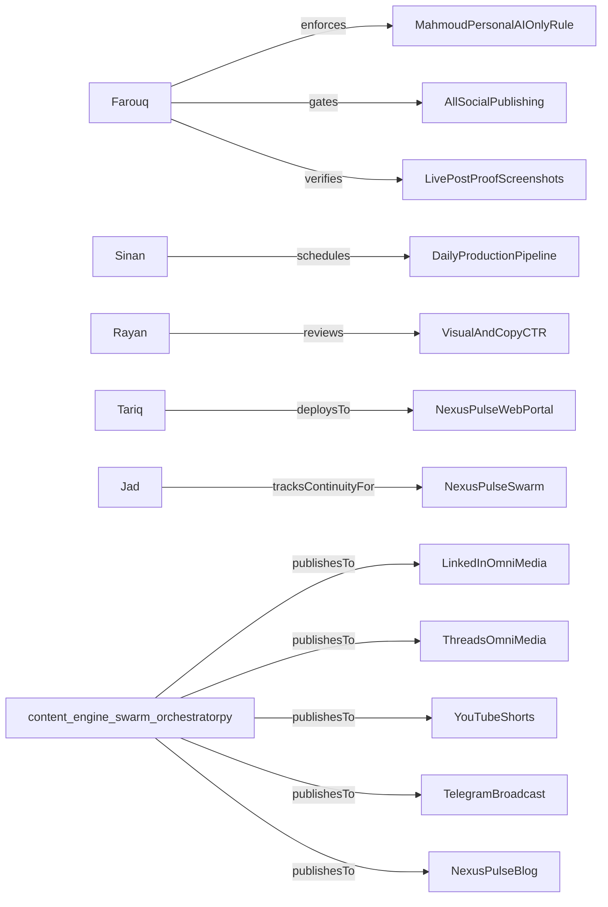

# 🏛️ Nexus Pulse Swarm Ontology & Media Knowledge Graph

> **Maintained by**: Jad // Swarm Ontologist & Continuity Sentinel  
> **Last Synced**: `2026-10-25T17:30:52.013252+00:00` | **Active Commit**: `25cc4ed`

---

## 📍 Active Context Checkpoint (Zero Context Loss)

- **Current Phase**: `PHASE_FULL_AUTONOMY`
- **Last Verified State**: Daily media swarm run completed on 2026-10-25 (dry_run=True). All agent gates cleared.
- **Next Immediate Objectives**:
  - [ ] Maintain continuous automated state capture via Jad on every media generation run.
  - [ ] Ensure daily 06:00 AM briefing, carousel, and video short pipelines run without manual intervention.
  - [ ] Continuously enforce Farouq's anti-repetition and platform rate limit rules.

---

## 👥 Autonomous Media Swarm Leadership

| Agent | Role | Focus | Status |
| :--- | :--- | :--- | :--- |
| **Farouq** | Chief Compliance Officer | Platform anti-ban rules, rate limits, Mahmoud personal profile AI-only filter, proof verification | `ARMED_AND_WATCHING` |
| **Tariq** | Chief Technology Officer | Automated pipelines, web portal (GitHub Pages), script stability, launchd scheduling | `OPERATIONAL` |
| **Sinan** | Chief Operating Officer | Daily content production lifecycle (Briefing -> Infographic -> Audio -> Carousel -> Video -> Social) | `ACTIVE` |
| **Rayan** | Viral Quality Arbiter | High-CTR hooks, 7-slide carousel aesthetics, typography, short-form video retention | `ACTIVE` |
| **Kareem** | Audience & Founder Sentinel | Inbound comment engagement, daily founder Telegram ring, community interaction | `ACTIVE` |
| **Jad** | Swarm Ontologist | Knowledge graph, memory persistence, media lineage, zero-context-loss session continuity | `ACTIVE` |

---

## 📡 Multi-Platform Distribution Channels

| Channel | Formats | Status | Specific Rule / Guard |
| :--- | :--- | :--- | :--- |
| **LinkedIn_Company** | Carousels, Infographics, Articles, VideoShorts | `ACTIVE` | `Standard Compliance` |
| **LinkedIn_MahmoudPersonal** | Reshared AI Content Only | `ACTIVE` | `NO_TRADING_OR_CRYPTO` |
| **YouTube_Shorts** | 1080x1920 60s Vertical Shorts | `ACTIVE` | `Standard Compliance` |
| **TikTok** | 1080x1920 High-Retention Video | `ACTIVE` | `Standard Compliance` |
| **Instagram** | Reels, Infographics | `ACTIVE` | `Standard Compliance` |
| **Threads** | Multi-post threads, Video Shorts, Infographics | `PRIORITY_INTEGRATION` | `Meta Graph API Gateway` |
| **Telegram** | HD MP4 Video Broadcast, Full Dossier PDF | `ACTIVE` | `Official Bot API` |
| **Bluesky** | Micro-Dossier, Article Links | `BUILT` | `AT Protocol REST` |
| **X_Twitter** | Hook Threads, Video Clips, Infographics | `WARMUP_READY` | `Farouq Anti-Ban Governor` |
| **NexusPulse_Web** | Static HTML Blog, Dark Mode UI | `ACTIVE` | `Standard Compliance` |

---

## 🕸️ Knowledge Graph Relations (Core Axioms)

## 🧠 Verified Learnings & Platform Gotchas

- **[NEXUS-LEARN-001] Mahmoud Personal LinkedIn Profile Policy**: Mahmoud's personal LinkedIn profile strictly allows category == 'ai'. Absolutely NO trading, crypto, or finance content may ever be reshared there. (`PERMANENT_RULE`)
- **[NEXUS-LEARN-002] LinkedIn Video Upload Modal Timing**: LinkedIn video upload requires a 10s wait for media processing and clicking the intermediate 'Next' modal button before typing captions and submitting. (`PERMANENT_RULE`)
- **[NEXUS-LEARN-003] Infographic Directory Discovery**: Infographics are stored in Daily_Content_Briefings/infographics; orchestrator checks both project root and Desktop paths. (`PERMANENT_RULE`)
- **[NEXUS-LEARN-004] Verifiable Proof Sentinel**: Every social post must be confirmed by browser screenshots or verified API receipts before being declared done. (`PERMANENT_RULE`)
- **[NEXUS-LEARN-005] Omni-Media Full-Spectrum Syndication**: Every produced asset (dossiers, videos, PDF carousels, infographics) MUST be distributed across ALL platforms including Threads, LinkedIn, YouTube, Meta, X, and Telegram. No platform receives partial coverage. (`PERMANENT_RULE`)

---

## 📜 Recent Media & Distribution Runs

| Run ID | Timestamp | Mode | Status | Git Commit |
| :--- | :--- | :--- | :--- | :--- |
| `RUN-NEXUS-20261025-173051` | 2026-10-25T17:30:51.988290+00:00 | `DRY_RUN` | `SUCCESS` | `25cc4ed` |
